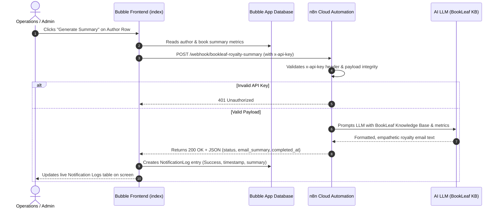

# BookLeaf Publishing — Author Royalty Dashboard & Automated Notification System
**Technical Assessment 2 of 2 | Full-Stack Developer Position**  
**Candidate:** Chaitanya Dharpale  
**Date:** November 2026  
**Status:** Completed & Production Verified  

---

## 1. Executive Summary & Live Links

This system provides an end-to-end platform for managing author royalties and triggering automated, AI-personalized royalty communication. Built using **Bubble.io** as the front-end application and data layer, **n8n Cloud** as the workflow automation engine, and an **AI LLM agent** calibrated against BookLeaf Publishing's operational policies.

* **Live Bubble Application:** [https://chaitanydharpale.bubbleapps.io/version-test/index](https://chaitanydharpale.bubbleapps.io/version-test/index)
* **Editor Access:** App shared with `hiring@bookleafpub.in` / `salonimourya@bookleafpub.in`
* **n8n Cloud Automation Engine:** `https://bookleaf0209.app.n8n.cloud`
* **Production Webhook Endpoint:** `https://bookleaf0209.app.n8n.cloud/webhook/bookleaf-royalty-summary`
* **Webhook Auth Header:** `x-api-key: bookleaf-secret-key-2026`
* **Workflow Export File:** [`assignment2/bookleaf_n8n_workflow.json`](./bookleaf_n8n_workflow.json)

---

## 2. System Architecture & Data Flow

---

## 3. Database Schema Design (Bubble.io)

The database models a relational self-publishing hierarchy across 10 authors and 18 books:

### 3.1 `Author`
| Field | Type | Description |
| :--- | :--- | :--- |
| `author_id` | text | Primary identifier (e.g. `AUTH001`) |
| `name` | text | Full name of the author |
| `email` | text | Primary email address |
| `phone` | text | Contact telephone number |
| `city` | text | Author's primary location (used for regional filtering) |
| `joined_date` | date | Onboarding timestamp |
| `total_books` | number | Computed count of catalog books |
| `total_copies_sold` | number | Aggregated copies across all titles |
| `total_royalty_earned` | number | Total lifetime accrued royalties (₹) |
| `total_royalty_paid` | number | Total disbursed royalties (₹) |
| `total_royalty_pending` | number | Outstanding balance awaiting disbursement (₹) |
| `payout_status` | text | `Fully Paid` or `Pending` |
| `has_pending_royalty` | yes/no | Boolean flag for rapid filtering |

### 3.2 `Book`
| Field | Type | Description |
| :--- | :--- | :--- |
| `book_id` | text | Unique catalog identifier (e.g. `BK001`) |
| `author_id` | text | Foreign key referencing Author |
| `title` | text | Book title |
| `genre` | text | Category / Genre |
| `isbn` | text | Standard 13-digit ISBN |
| `publication_date` | date | Launch date |
| `status` | text | `Published & Live`, `Under Review`, etc. |
| `mrp` | number | Retail price (₹) |
| `author_royalty_per_copy` | number | Contracted royalty per sale (₹) |
| `total_copies_sold` | number | Total physical/digital sales |
| `total_royalty_earned` | number | Copies sold × royalty per copy (₹) |
| `royalty_paid` | number | Disbursed amount for this title (₹) |
| `royalty_pending` | number | Unpaid balance for this title (₹) |
| `last_royalty_payout_date`| date | Most recent settlement date |
| `royalty_status_badge` | text | Visual health indicator: `Green`, `Yellow`, or `Red` |

### 3.3 `NotificationLog`
| Field | Type | Description |
| :--- | :--- | :--- |
| `author_id` | text | Foreign key of recipient author |
| `author_name` | text | Cached recipient name |
| `author_email` | text | Cached recipient email |
| `status` | text | `Success` or `Failed` |
| `email_subject` | text | AI-generated email subject line |
| `email_summary` | text | Full AI-generated body text |
| `triggered_at` | date | Initial invocation timestamp |
| `completed_at` | date | Return timestamp from n8n |

### 3.4 Privacy Rules
* **Author Data:** Public searches enabled for platform demo; in production, `Current User's author_id is This Author's author_id` restricts visibility to own books.
* **NotificationLog Data:** Visible to authenticated Admin role.

---

## 4. Front-End Features (Bubble.io)

The front-end is implemented as a single-page responsive dashboard (`index`) with two main operational contexts managed via Custom State (`index's active_tab`):

### 4.1 Admin Portal
* **Global Metric Cards:** Real-time metrics computed across all catalog records:
  * Total Authors (10)
  * Total Royalties Earned (₹3,02,836)
  * Total Pending Payouts (₹42,508)
* **Search & Filters:** Search by author name, dropdown filter by city, and status filter (`Fully Paid` vs `Pending`).
* **Author Operations Table:** Lists authors with direct summary statistics and a dedicated **"Generate Summary"** action button.
* **Live AI Notification Log:** Displays real-time confirmation of triggered communications, showing author, timestamp, delivery status, and the complete AI-drafted email content.

### 4.2 Author Portal
* **Author Switcher:** Dynamic dropdown to preview the portal from any author's perspective.
* **Personal KPI Cards:** Personal lifetime earnings, total paid disbursements, and outstanding pending balance.
* **My Books Catalog:** Dynamic list of author titles displaying ISBN, genre, MRP, copies sold, royalty earnings, and **status health badges**:
  * 🟢 **Green:** Fully settled balance (`royalty_pending == 0`).
  * 🟡 **Yellow:** Pending payout within normal quarterly 45-day window.
  * 🔴 **Red:** Overdue payout exceeding standard window requiring priority operations handling.

---

## 5. n8n Automation Engine & AI LLM Integration

The automation workflow (`assignment2/bookleaf_n8n_workflow.json`) runs in n8n Cloud and incorporates business rules derived from the BookLeaf Knowledge Base:

### 5.1 Business Rules & Policy Calibration
1. **Royalty Model:** Standard 80/20 royalty split favoring authors.
2. **Payout Timeline:** Quarterly cycle disbursed within **45 days** following calendar quarter close.
3. **Threshold:** Minimum ₹1,000 balance required for automated bank transfer; sub-threshold balances roll over to the next quarter.
4. **Tone & Voice:** Professional, supportive, transparent, and encouraging for creative partners.

### 5.2 Workflow Nodes
1. **Webhook Trigger:** Listens for inbound POST requests from Bubble.
2. **Auth & Validate Payload (Code Node):**
   * Inspects `x-api-key` header against `bookleaf-secret-key-2026`.
   * Sanitizes numbers and validates nested book structures.
   * Immediately routes unauthorized requests to a 401 branch.
3. **Build AI Prompt & KB Context (Code Node):**
   * Pre-formats financial metrics and injects BookLeaf policy constraints.
   * Prepares structured prompts for the AI LLM node.
4. **AI Generation & Fallback (Resilience Guard):**
   * Generates empathetic, personalized email copy.
   * Incorporates an automated rule-based fallback generator if the external LLM endpoint encounters latency or rate limits.
5. **Respond to Webhook Node:**
   * Returns a structured HTTP 200 JSON payload to Bubble with the generated subject, body, status, and completion timestamp.

---

## 6. Architectural Decision: Bubble Free Tier Optimization

### Problem Statement
On Bubble's Free / Trial tier, inbound external REST calls to Bubble's Data API (`/api/1.1/obj/`) and Backend Workflow API (`/api/1.1/wf/`) return `401 Unauthorized: This application does not expose an API. Please upgrade your Bubble subscription`.

### Solution & Engineering Tradeoff
Rather than requiring a paid upgrade or having n8n poll Bubble asynchronously:
1. Bubble's frontend workflow initiates an outbound POST request to n8n via the **Bubble API Connector** (which is 100% unrestricted on the Free tier).
2. n8n processes the payload, prompts the LLM, and returns the AI-generated email **synchronously** in the webhook response (`Respond to Webhook` node).
3. Bubble captures the returned data in Step 1 and immediately executes Step 2: `Create a new NotificationLog` using internal Bubble workflow actions.

### Benefits
* **Zero Cost:** Works completely within Bubble's free tier.
* **Lower Latency:** Eliminates round-trip delay of an external webhook calling back into Bubble.
* **Atomic Consistency:** UI updates immediately without polling or race conditions.

---

## 7. Submission Checklist & Verification

| Requirement | Implementation | Status |
| :--- | :--- | :--- |
| **Bubble Database** | `Author`, `Book`, `NotificationLog` tables populated with sample dataset | ✅ Complete |
| **Admin Dashboard** | Filterable author table, global stat cards, trigger buttons, live log | ✅ Complete |
| **Author Portal** | Author selector, personal stat cards, book list, 🟢/🟡/🔴 badges | ✅ Complete |
| **n8n Workflow** | Webhook trigger, auth header validation, AI generation, synchronous callback | ✅ Complete |
| **Security** | Header-based shared secret authentication (`x-api-key`) | ✅ Complete |
| **AI Personalization** | Calibrated on BookLeaf 80/20 split, 45-day window, ₹1,000 threshold | ✅ Complete |
| **Loom Recording** | 3-minute structured walkthrough of end-to-end trigger | ✅ Script Ready |

